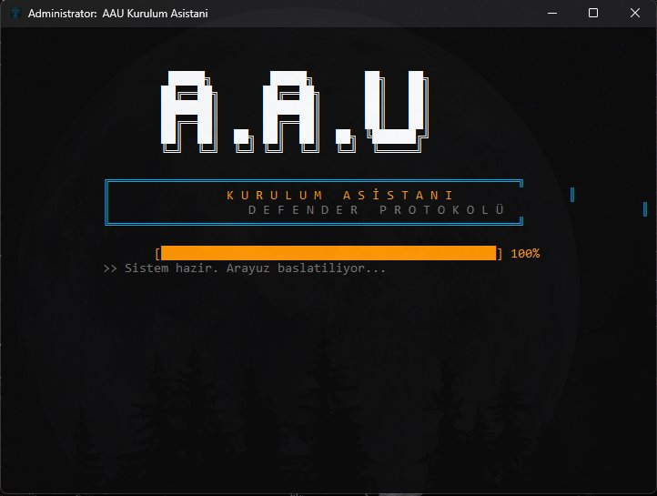
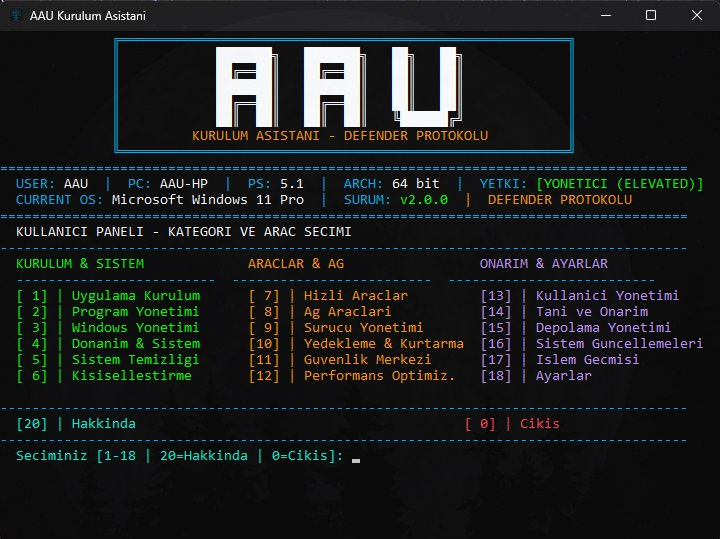
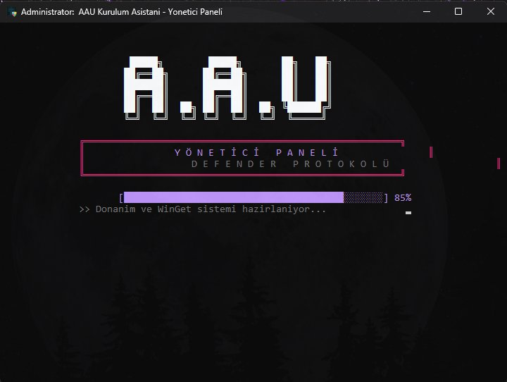
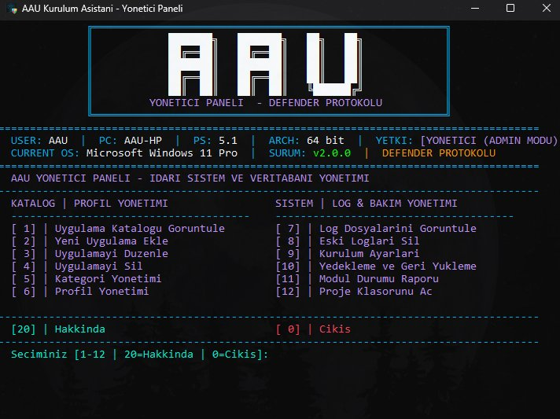
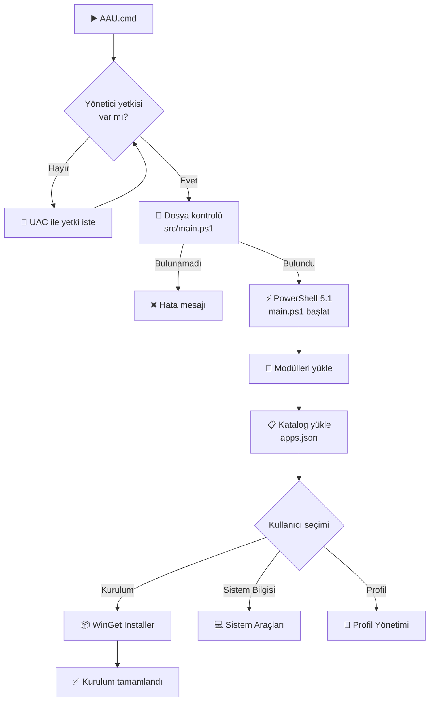

<p align="center">
  
</p>

<h1 align="center">🚀 AAU Kurulum Asistanı</h1>

<p align="center">
  <strong>Windows uygulama kurulum deneyimini tek merkezden yöneten akıllı asistan.</strong><br/>
  <em>Kurulumu düşünme — AAU düşünsün.</em>
</p>

<p align="center">
  <a href="https://github.com/ardaustunel55/AAU_Kurulum_Asistani">
    
  </a>
  
  
  
  
  
</p>

<p align="center">
  <a href="#-genel-bakış">Genel Bakış</a> •
  <a href="#-öne-çıkan-özellikler">Özellikler</a> •
  <a href="#-ekran-görüntüleri">Ekran Görüntüleri</a> •
  <a href="#-hızlı-başlangıç">Kurulum</a> •
  <a href="#-mimari">Mimari</a> •
  <a href="#-katalog-istatistikleri">Katalog</a> •
  <a href="#-güvenlik">Güvenlik</a> •
  <a href="#-yol-haritası">Yol Haritası</a> •
  <a href="#-kaynakça">Kaynakça</a>
</p>

---

## 📖 Genel Bakış

**AAU Kurulum Asistanı**, Windows 10/11 bilgisayarlarda format sonrası kurulum, sistem bakımı, gizlilik/debloat ve yazılım yönetimi süreçlerini baştan sona otomatikleştiren, PowerShell tabanlı modüler bir masaüstü uygulamasıdır. JSON tabanlı merkezi katalog sistemi sayesinde **74 doğrulanmış uygulama** ve **9 hazır kurulum profili** sunarak [Windows Package Manager (WinGet)](https://learn.microsoft.com/windows/package-manager/winget/), Microsoft Store ve Direct URL kaynakları üzerinden kurulum yapabilir.

> **💡 Neden AAU?**  
> Yeni bir Windows kurulumu sonrası saatler süren "indir → kur → tekrarla" döngüsünü ortadan kaldırır. Kategori bazlı uygulama seçimi, profil desteği ve toplu kurulum ile dakikalar içinde iş istasyonunuzu hazır hale getirir.

### 🎯 Temel Hedefler

| Hedef | Açıklama |
|:------|:---------|
| 🗂️ **Merkezi Katalog** | Tüm uygulamaları kategori, paket bilgisi ve kaynak türüyle tek noktada toplar |
| ⚡ **Tek Tıkla Kurulum** | WinGet entegrasyonuyla sessiz ve otomatik kurulum sağlar |
| 🧩 **Modüler Mimari** | Her işlev bağımsız PowerShell modüllerinde; genişletmesi kolay |
| 🔍 **Akıllı Kontrol** | Kurulum öncesi WinGet, internet bağlantısı ve paket kaynağını otomatik denetler |
| 👤 **Profil Sistemi** | Farklı kullanım senaryoları için özelleştirilebilir kurulum profilleri |
| 🛡️ **Yönetici Paneli** | Katalog düzenleme, profil yönetimi ve gelişmiş sistem araçları |

---

## ✨ Öne Çıkan Özellikler

<table>
  <tr>
    <td width="50%">

### 📦 Uygulama Kataloğu
- **74 uygulama** kaydı (8 kategori) ve **9 profil**
- WinGet, Microsoft Store ve Direct URL kaynak desteği
- JSON tabanlı, kolayca genişletilebilir yapı
- Kategori bazlı filtreleme, arama ve kayıt defteri temizliği

</td>
    <td width="50%">

### 🖥️ Kullanıcı Arayüzü
- Renkli ve düzenli konsol arayüzü
- Kategori tabanlı navigasyon
- İlerleme çubukları ve durum göstergeleri
- UTF-8 tam karakter desteği

</td>
  </tr>
  <tr>
    <td>

### ⚙️ Kurulum Motoru
- WinGet üzerinden sessiz kurulum
- Toplu uygulama kurulum desteği
- Otomatik bağımlılık kontrolü
- Kurulum geçmişi ve loglama

</td>
    <td>

### 🔧 Yönetici Paneli
- Katalog CRUD işlemleri
- Profil oluşturma ve yönetimi
- Sistem bilgi raporları
- Donanım ve yazılım envanter çıkarımı

</td>
  </tr>
  <tr>
    <td>

### 📊 Sistem Araçları
- Donanım bilgisi toplama
- Disk, RAM ve CPU analizi
- Sistem raporu oluşturma
- Ağ bağlantı denetimi

</td>
    <td>

### 🛡️ Güvenlik
- Salt okunur varsayılan çalışma modu
- Kullanıcı onaysız işlem yapılmaz
- Yönetici yetkileri UAC ile kontrol edilir
- Hassas veri koruması

</td>
  </tr>
</table>

---

## 📸 Ekran Görüntüleri

### Kullanıcı Paneli

<p align="center">
  
  <br/><em>Açılış Ekranı — Defender Protokolü yükleme animasyonu</em>
</p>

<p align="center">
  
  <br/><em>Ana Menü — 22 seçenekli uygulama kurulumu, sistem bakımı, debloat ve format sonrası sihirbazı</em>
</p>

### Yönetici Paneli

<p align="center">
  
  <br/><em>Yönetici Paneli — Açılış ve sistem hazırlığı</em>
</p>

<p align="center">
  
  <br/><em>Yönetici Paneli — Katalog, profil ve sistem yönetim araçları</em>
</p>

---

## 🚀 Hızlı Başlangıç

### Yöntem 1: Tek Komutla Kurulum ⚡

PowerShell penceresini açın ve aşağıdaki komutu çalıştırın:

```powershell
irm https://raw.githubusercontent.com/ardaustunel55/AAU_Kurulum_Asistani/master/Start-AAU.ps1 | iex
```

> ⚠️ **Güvenlik notu:** Bu komut GitHub'daki betiği indirir ve çalıştırır. Uzak betikleri çalıştırmadan önce [kaynak kodunu](https://github.com/ardaustunel55/AAU_Kurulum_Asistani/blob/master/Start-AAU.ps1) inceleyin.

**Başlangıç betiği şunları yapar:**
1. 📥 GitHub'dan proje arşivini indirir
2. 📂 `%LOCALAPPDATA%\AAU_Kurulum_Asistani` konumuna yerleştirir
3. ✅ Dosya bütünlüğünü doğrular (`AAU.cmd` + `src/main.ps1`)
4. 🚀 Uygulamayı otomatik olarak başlatır

### Yöntem 2: Manuel Kurulum 🔧

```powershell
# Depoyu klonlayın
git clone https://github.com/ardaustunel55/AAU_Kurulum_Asistani.git

# Proje dizinine gidin
cd AAU_Kurulum_Asistani

# WinGet kurulu olduğundan emin olun
winget --version

# Uygulamayı başlatın
.\AAU.cmd
```

### Sistem Gereksinimleri

| Gereksinim | Minimum |
|:-----------|:--------|
| 💻 **İşletim Sistemi** | Windows 10 (1809+) veya Windows 11 |
| ⚡ **PowerShell** | Windows PowerShell 5.1 |
| 📦 **Paket Yöneticisi** | WinGet / App Installer |
| 🌐 **İnternet** | İlk indirme ve çevrimiçi kurulumlar için |
| 💾 **Disk Alanı** | Kurulacak uygulamalara bağlı |
| 🔑 **Yetki** | Bazı uygulamalar için yönetici izni |

---

## 🏗️ Mimari

### Klasör Yapısı

```
AAU_Kurulum_Asistani/
│
├── 📁 assets/                    # Görsel kaynaklar
│   ├── logo.png                  #   Uygulama logosu
│   ├── aau.ico                   #   Kullanıcı paneli ikonu
│   └── admin.ico                 #   Yönetici paneli ikonu
│
├── 📁 config/                    # Yapılandırma
│   └── settings.json             #   Uygulama ayarları
│
├── 📁 data/                      # Veri katmanı
│   ├── apps/
│   │   └── apps.json             #   📦 Ana uygulama kataloğu (74 kayıt)
│   ├── backups/                  #   Otomatik yedekler
│   └── profiles/
│       └── profiles.json         #   👤 Kurulum profilleri (9 profil)
│
├── 📁 modules/                   # PowerShell modülleri (11 modül)
│   ├── admin/                    #   🔧 Yönetici paneli modülleri
│   │   ├── admin_core.psm1       #     Çekirdek yönetim işlevleri
│   │   ├── admin_catalog.psm1    #     Katalog CRUD işlemleri
│   │   └── admin_profiles.psm1   #     Profil yönetimi
│   ├── installer/                #   📥 Kurulum motoru modülleri
│   │   ├── winget_installer.psm1 #     WinGet & Direct URL kurulum işlemleri
│   │   ├── winget_check.psm1     #     WinGet doğrulama
│   │   ├── catalog_manager.psm1  #     Katalog işlemleri
│   │   ├── program_manager.psm1  #     Program yönetimi ve kayıt defteri temizliği
│   │   └── shortcut_manager.psm1 #     Kısayol işlemleri
│   └── system/                   #   💻 Sistem araçları modülleri
│       ├── hardware_info.psm1    #     Donanım bilgisi
│       ├── system_tools.psm1     #     Sistem araçları
│       └── post_format_tools.psm1#     Format sonrası sihirbazı, debloat & optimizasyon
│
├── 📁 src/                       # Kaynak kodu
│   └── main.ps1                  #   🎯 Ana giriş noktası (v2.0.0)
│
├── 📁 .github/                   # Issue ve PR şablonları
├── 📁 logs/                      # Çalışma günlükleri
├── 📁 reports/                   # Sistem raporları
│
├── AAU.cmd                       # ▶️ Kullanıcı başlatıcısı
├── Start-AAU.ps1                 # 📥 İlk kurulum betiği
├── test_runner.ps1               # 🧪 Otomatik test paketi (62 senaryo)
├── CHANGELOG.md                  # 📝 Sürüm değişiklik günlüğü
├── LICENSE                       # 📄 MIT Lisansı
└── README.md                     # 📄 Bu dosya
```

### Çalışma Akışı



---

## 📊 Katalog İstatistikleri

<table>
  <tr>
    <td align="center"><h3>74</h3><sub>Toplam Uygulama</sub></td>
    <td align="center"><h3>8</h3><sub>Kategori</sub></td>
    <td align="center"><h3>72</h3><sub>WinGet Kaynağı</sub></td>
    <td align="center"><h3>2</h3><sub>MS Store & Direct URL</sub></td>
  </tr>
</table>

### 📂 Kategori Dağılımı

| Emoji | Kategori | Uygulama Sayısı | Oran |
|:-----:|:---------|:---------------:|:----:|
| 🛠️ | Temel Sistem Araçları ve Sıkıştırma | 19 | %26 |
| 🎬 | Medya, Görsel ve Ses | 13 | %18 |
| 💻 | Geliştirici ve Kodlama Araçları | 11 | %15 |
| 💬 | İletişim | 9 | %12 |
| 🌐 | Tarayıcılar | 8 | %11 |
| 📄 | Ofis ve Doküman | 6 | %8 |
| 🎮 | Oyun Platformları | 4 | %5 |
| ⚙️ | Runtime Bileşenleri | 4 | %5 |

### 🏷️ Örnek Uygulamalar

<details>
<summary><b>🌐 Tarayıcılar</b> — 8 uygulama</summary>

| Uygulama | Kaynak |
|:---------|:-------|
| Google Chrome | WinGet |
| Mozilla Firefox | WinGet |
| Brave Browser | WinGet |
| Microsoft Edge | WinGet |
| Opera / Opera GX | WinGet |
| *ve daha fazlası...* | |

</details>

<details>
<summary><b>💻 Geliştirici Araçları</b> — 11 uygulama</summary>

| Uygulama | Kaynak |
|:---------|:-------|
| Visual Studio Code | WinGet |
| Git | WinGet |
| Node.js | WinGet |
| Python | WinGet |
| *ve daha fazlası...* | |

</details>

<details>
<summary><b>🛠️ Sistem Araçları</b> — 19 uygulama</summary>

| Uygulama | Kaynak |
|:---------|:-------|
| 7-Zip | WinGet |
| WinRAR | WinGet |
| CCleaner | WinGet |
| CPU-Z | WinGet |
| *ve daha fazlası...* | |

</details>

<sub>📋 Tam liste için <a href="data/apps/apps.json"><code>data/apps/apps.json</code></a> dosyasına bakınız.</sub>

---

## 🔧 Kullanılan Teknolojiler

<p align="center">
  
  
  
  
  
  
</p>

| Teknoloji | Projedeki Rolü |
|:----------|:---------------|
| **Windows PowerShell 5.1** | Tüm betikler, modüller, sistem kontrolleri ve arayüz |
| **Windows CMD** | UAC yönetimi ve uygulama başlatıcı |
| **WinGet** | Paket keşfi, kurulum ve yönetim |
| **Microsoft Store** | Mağaza kaynaklı uygulama kurulumları |
| **JSON** | Uygulama kataloğu, profiller ve yapılandırma |
| **Git & GitHub** | Sürüm kontrolü ve kaynak kod barındırma |

---

## 🛡️ Güvenlik

> **AAU, güvenliği tasarım prensibi olarak benimser.**

- 🔒 **Salt okunur varsayılan mod** — Kullanıcı onayı olmadan hiçbir işlem gerçekleştirilmez
- 🛡️ **UAC entegrasyonu** — Yönetici yetkileri Windows güvenlik mekanizmasıyla yönetilir
- 🔍 **Kaynak doğrulama** — Paket kimliği ve kaynağı kurulum öncesi kontrol edilir
- 🚫 **Hassas veri koruması** — Parola, API anahtarı veya kişisel veri depoya eklenmez
- 📋 **Şeffaf loglama** — Tüm işlemler `logs/` dizininde kayıt altına alınır
- ⚠️ **Uzak betik uyarısı** — `Start-AAU.ps1` çalıştırılmadan önce kaynak kodu incelenmelidir

---

## 🛣️ Yol Haritası

- [x] ✅ JSON tabanlı merkezi uygulama kataloğu (74 doğrulanmış uygulama)
- [x] ✅ WinGet, Microsoft Store ve Direct URL kaynak desteği
- [x] ✅ 8 kategori ile uygulama sınıflandırması
- [x] ✅ Modüler PowerShell mimari (11 modül)
- [x] ✅ Profil tabanlı toplu kurulum sistemi (9 profil)
- [x] ✅ Format Sonrası Sihirbazı ve Debloat & Gizlilik Merkezi
- [x] ✅ Yönetici paneli ve katalog yönetim araçları
- [x] ✅ Donanım bilgisi, sürücü, ağ ve sistem raporlama
- [x] ✅ Sürüm geçmişi ve detaylı değişiklik günlüğü ([CHANGELOG.md](CHANGELOG.md))
- [x] ✅ 62 senaryolu otomatik test paketi (`test_runner.ps1`)
- [x] ✅ GitHub üzerinden tek komutla kurulum betiği
- [ ] 🔄 Bütünlük doğrulamalı otomatik güncelleme mekanizması
- [ ] 📊 Gelişmiş kurulum geçmişi ve istatistikleri
- [ ] 🔏 İmzalı dağıtım paketi
- [ ] 🌍 Çoklu dil desteği (i18n)

---

## 🐛 Sorun Giderme

<details>
<summary><b>❓ WinGet bulunamıyor</b></summary>

```powershell
# WinGet sürümünü kontrol edin
winget --version
```

Komut tanınmıyorsa Microsoft Store'dan **App Installer** bileşenini yükleyin veya güncelleyin.

</details>

<details>
<summary><b>❓ Katalog yüklenemiyor</b></summary>

```powershell
# JSON geçerliliğini test edin
Get-Content .\data\apps\apps.json -Raw | ConvertFrom-Json
```

Hata alıyorsanız, `data/backups/` dizinindeki son yedeği geri yükleyin.

</details>

<details>
<summary><b>❓ Ana dosya (main.ps1) bulunamıyor</b></summary>

`src\main.ps1` dosyasının proje kök dizininde var olduğunu doğrulayın:

```powershell
Test-Path .\src\main.ps1
```

</details>

<details>
<summary><b>❓ GitHub arşivi indirilemiyor</b></summary>

1. İnternet bağlantınızı kontrol edin
2. [Depo adresinin](https://github.com/ardaustunel55/AAU_Kurulum_Asistani) erişilebilir olduğunu doğrulayın
3. `master` dalının mevcut olduğundan emin olun

</details>

---

## 🤝 Katkıda Bulunma

Katkılarınız projeyi daha iyi hale getirir! 🎉

```powershell
# 1. Depoyu fork edin, ardından klonlayın
git clone https://github.com/<KULLANICI_ADINIZ>/AAU_Kurulum_Asistani.git

# 2. Yeni bir dal oluşturun
git checkout -b feature/harika-ozellik

# 3. Değişikliklerinizi commit edin
git add .
git commit -m "feat: harika yeni özellik eklendi"

# 4. Dalınızı push edin
git push origin feature/harika-ozellik

# 5. GitHub üzerinden Pull Request açın 🚀
```

**📌 Katkı kuralları:**
- Mevcut klasör yapısını koruyun
- Geçici veya test dosyalarını commit etmeyin
- Gizli bilgileri (parola, API anahtarı) kesinlikle eklemeyin
- Commit mesajlarında [Conventional Commits](https://www.conventionalcommits.org/) kurallarına uyun

---

## 💡 Geliştirme Fikirleri

Projeye katkı sağlamak isteyenler için bazı fikirler:

| Öncelik | Fikir | Açıklama |
|:-------:|:------|:---------|
| 🔴 | **Otomatik güncelleme** | Sürüm karşılaştırmalı güncelleme mekanizması |
| 🔴 | **Pester test altyapısı** | Modüller için birim ve entegrasyon testleri |
| 🟡 | **CHANGELOG.md** | Her sürüm için detaylı değişiklik günlüğü |
| 🟡 | **Çevrimdışı mod** | İnternet olmadan önceden indirilmiş paketlerle kurulum |
| 🟢 | **Tema desteği** | Konsol renk şemalarını özelleştirme |
| 🟢 | **Dışa/İçe aktarma** | Kurulum profillerini dosya olarak paylaşma |
| 🟢 | **Çoklu dil** | Türkçe dışında İngilizce destek |

---

## 📚 Kaynakça

### 📘 Resmi Belgeler

| Kaynak | Bağlantı | Açıklama |
|:-------|:---------|:---------|
| WinGet Belgeleri | [learn.microsoft.com/windows/package-manager/winget](https://learn.microsoft.com/windows/package-manager/winget/) | Windows Paket Yöneticisi resmi belgeleri |
| WinGet `install` Komutu | [learn.microsoft.com/.../winget/install](https://learn.microsoft.com/windows/package-manager/winget/install) | Paket kurulum komutu referansı |
| WinGet CLI Kaynak Kodu | [github.com/microsoft/winget-cli](https://github.com/microsoft/winget-cli) | WinGet açık kaynak deposu |
| PowerShell Belgeleri | [learn.microsoft.com/powershell](https://learn.microsoft.com/powershell/) | PowerShell resmi belgeleri |
| Git Belgeleri | [git-scm.com/doc](https://git-scm.com/doc) | Git resmi dokümantasyonu |
| GitHub Docs | [docs.github.com](https://docs.github.com/) | GitHub platform belgeleri |

### 📗 Faydalı Kaynaklar

| Kaynak | Bağlantı |
|:-------|:---------|
| WinGet Paket Deposu | [github.com/microsoft/winget-pkgs](https://github.com/microsoft/winget-pkgs) |
| PowerShell Gallery | [powershellgallery.com](https://www.powershellgallery.com/) |
| Conventional Commits | [conventionalcommits.org](https://www.conventionalcommits.org/) |
| Pester Test Framework | [pester.dev](https://pester.dev/) |

> 📌 *Katalogdaki üçüncü taraf uygulamalar kendi geliştiricilerinin lisans koşullarına tabidir.*

---

## 👨‍💻 Geliştirici

<table>
  <tr>
    <td align="center">
      <a href="https://github.com/ardaustunel55">
        <br/>
        <sub><b>Ali Arda Üstünel</b></sub>
      </a>
      <br/>
      <a href="https://github.com/ardaustunel55" title="GitHub">
        
      </a>
    </td>
  </tr>
</table>

---

<p align="center">
  
  <br/>
  <strong>AAU Kurulum Asistanı</strong><br/>
  <em>Windows uygulama kurulum sürecini daha düzenli ve erişilebilir hâle getirmek için.</em><br/><br/>
  <sub>⭐ Projeyi beğendiyseniz yıldız vermeyi unutmayın!</sub><br/><br/>
  <sub>© 2026 Ali Arda Üstünel — Tüm hakları saklıdır.</sub>
</p>
